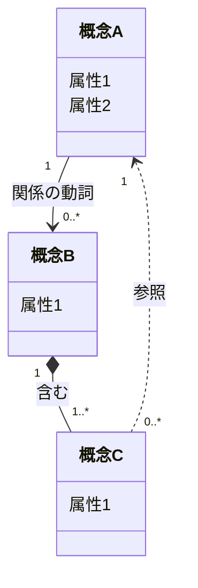

# 概念モデル図（{事業・システム名}）

## 1. 概念の関係

業務の概念と、その関係を図にする。技術詳細は入れず、DBのER図とは別物として描く。

図中の「概念A〜C」「属性」「関係の動詞」は、自分の言葉に置き換える（`{}` は Mermaid の構文と衝突するので使わない）。

実線の太い関係（`*--`）は **同じまとまりの内側**、点線（`..>`）は **IDで参照するだけ**（まとまりをまたぐ）。

書き方のコツ:
- 概念名と属性名は、ユビキタス言語集の用語に揃える
- 業務フローに出てきた名詞を、まず概念の候補として置く
- 多重度（1、0..1、0..*、1..*）で、業務のルールを読み取れるようにする

## 2. 集約・エンティティ・値オブジェクトの候補

図の概念を、設計上の役割（集約ルート、エンティティ、値オブジェクトなど）に振り分ける。役割ごとに根拠を書き、あとで設計を見直す手がかりにする。

| 種類 | 概念 | 根拠 |
|---|---|---|
| 集約ルート | {概念} | {他から単独で参照される理由、整合性を保つ範囲} |
| 子エンティティ | {概念} | {どの集約の内側か、単独で存在しない理由} |
| 値オブジェクト | {概念} | {不変条件、同じ値なら同じものとみなせる理由} |
| ドメインサービス | {判定・計算の名前} | {どの集約にも置きにくい理由} |

判断の目安:
- **集約ルート**: IDで識別され、他から単独で参照される。内側の整合性をまとめて守る
- **子エンティティ**: 集約の内側にあり、ルートを通してのみ扱う
- **値オブジェクト**: 値そのものに意味があり、同じ値なら同じものとして扱える。範囲や形式の制約を持たせたい
- **ドメインサービス**: 複数の集約をまたぐ判定・計算で、どの集約にも自然に置けないもの

## 3. 気づき

モデルを描いて分かったこと、設計上の論点、見直したい点を書く。決めきれないものは未解決事項の文書へ移す。

- {気づき}
